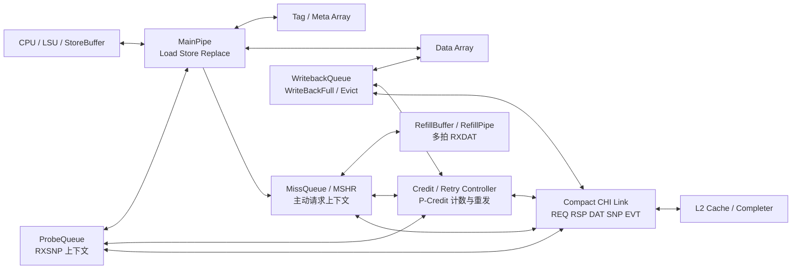

# L1 DCache–L2 Compact CHI 设计基线

状态：学习阶段的第一版架构基线，尚未进入 RTL 实现。
更新：2026-10-19

## 目标

设计一个面向 L1 DCache 与 L2 Cache 的 Compact CHI 接口，支持：

- Load Miss；
- Store Miss/部分字段 Store；
- 整行覆盖写且不分配本地副本；
- 干净缓存行驱逐；
- 脏缓存行写回；
- L2 发起的 Snoop；
- 多拍缓存行数据；
- 基本 P-Credit、Retry 和反压处理。

当前目标是先得到可评审的协议级状态机和接口方案，再翻译为 Chisel。

## 设计范围与暂不实现

本版聚焦 Type 1 L1 DCache 到 L2 的主路径。ACE、其他组件 Type 2–5、QoS、Way 预测、虚拟地址别名和原子事务暂不作为第一版 RTL 的前置条件。

本地 Compact CHI 草稿中原子事务流程仍为 TBD；不要在没有明确协议定义的情况下自行补全原子事务行为。

## 组件架构



图中 `TX/RX` 均从 L1 视角理解：

```text
L1 -> L2：TXREQ / TXEVT / TXRSP / TXDAT
L2 -> L1：RXRSP / RXDAT / RXSNP
```

## 状态模型

第一版使用 Compact CHI 逻辑状态：

| 状态 | 含义 | 是否可写 | Dirty 责任 |
|---|---|---:|---:|
| `I` | 无有效缓存行 | 否 | 否 |
| `SC` | Shared Clean | 否 | 否 |
| `UC` | Unique Clean | 是 | 否 |
| `UD` | Unique Dirty | 是 | 是 |

主要转换：

```text
I  --ReadShared-->  SC
I  --ReadUnique-->  UC
I  --Store after UC--> UD
SC --authorized ReadUnique--> UC
UC --local Store--> UD
SC/UC --SnpToInvalid--> I
UD --SnpToInvalid + SnpRespData--> I
UD --SnpToShared + SnpRespData--> SC
UD --SnpToClean + SnpRespData--> UC
UD --WriteBackFull--> I
SC/UC --Evict--> I
```

`SC -> UC` 不能由 L1 单方面完成，必须经过 L2/一致性管理者协调。

## 接口消息表

| 场景 | L1 发出 | L2 可能发出 | L1 最终状态 |
|---|---|---|---|
| Load Miss | `TXREQ ReadShared` | `RXDAT CompData`、完成响应 | `SC` 为常见结果 |
| Store Miss/部分写 | `TXREQ ReadUnique` | 必要时 `RXSNP`，返回 `RXDAT CompData`/状态 | `UC -> UD` |
| 整行覆盖且不分配 | `TXREQ WriteUniqueFull` | `RXRSP CompDBIDResp` | `I` |
| 干净驱逐 | `TXEVT Evict` | `RXRSP Comp` | `I` |
| 脏行写回 | `TXEVT WriteBackFull` | `RXRSP DBIDResp/CompDBIDResp`、`Comp` | `I` |
| 干净 Snoop 失效 | `RXSNP SnpToInvalid` | — | `I`，`TXRSP SnpResp` |
| 脏 Snoop 失效 | `RXSNP SnpToInvalid` | — | `I`，`TXDAT SnpRespData` |

Compact CHI 草稿允许 Snoop 采用：

```text
状态-only：TXRSP / SnpResp
状态+数据：TXDAT / SnpRespData
```

带数据的 Snoop 不强制额外发送一条独立的 `SnpResp`。

## 队列职责

### MSHR / MissEntry

记录 L1 主动发出的未完成请求：

```text
line_addr
request_type
original_txn_id
remote_dbid（如果收到）
target/granted state
received_mask
critical_word_id
snoop_pending
retry_pending
merged loads/stores
```

### RefillBuffer / RefillPipe

负责：

- 接收 `RXDAT/CompData`；
- 根据 `DataID` 拼接缓存行；
- 维护 `received_mask`；
- 支持 critical-word-first；
- 在所有数据和排序条件满足后提交 Tag/Meta/Data。

### ProbeQueue

负责：

- 接收 `RXSNP`；
- 保存 Snoop TxnID、地址、Opcode；
- 查 Tag/Meta 和 MSHR；
- 生成 `TXRSP/SnpResp` 或 `TXDAT/SnpRespData`；
- 处理同地址主动请求与 Snoop 的瞬态冲突。

### WritebackQueue

负责：

- `WriteBackFull`；
- `Evict`；
- 多拍 `CopyBackWrData`；
- 在 `TXDAT` 反压下保持脏数据；
- 等待正确的 `DBIDResp/Comp` 完成条件。

## ID 规则

```text
原始 TxnID：用于 L1 找到自己的 MSHR/WritebackEntry
返回 DBID：由 L2 分配，用于后续 UpRSP/UpDAT 关联
SrcID：消息来源节点
TgtID：消息目标节点
DataID：缓存行多拍数据中的 beat 位置
```

示例：

```text
TXEVT WriteBackFull：TxnID=9
RXRSP CompDBIDResp：TxnID=9，DBID=4
TXDAT CopyBackWrData：TxnID=4
```

## Retry 与 Credit 基线

当前第一版约定：

- `TXREQ` 采用动态 P-Credit + Retry；
- `RXSNP` 采用静态接收容量，通常不依赖 Retry；
- Retry 通知匹配已有请求，不分配第二个 MSHR；
- Retry 等待期间保留原始请求上下文；
- 重发前必须获得 Retry 指定的全部静态资源；
- 首次发送 `AllowRetry=1`，重发 `AllowRetry=0`；
- 一个 Credit 只能被一个重发者消费；
- ProbeQueue 的 Credit 要扣除已占用和已承诺容量。

## 第一版优先级

参考本地 Kunminghu DCache 文档的 MainPipe 优先级：

```text
Probe > Replace > Store > Atomic
```

第一版先实现：

```text
Probe > Replace > Store
```

Atomic 暂不实现。

## 开发顺序

1. 固化本文件中的消息和状态表；
2. 决定 Cache line bytes、Data width、最大 beat 数；
3. 定义 Chisel Bundle：REQ/RSP/DAT/SNP/EVT；
4. 定义 MSHR、ProbeEntry、WritebackEntry；
5. 先实现无 Retry 的正常 ReadShared；
6. 加入 ReadUnique 和 Store；
7. 加入 Snoop；
8. 加入多拍数据和反压；
9. 加入 WriteBackFull/Evict；
10. 加入 Credit/Retry；
11. 加入 Chisel `assert` 和 directed tests。

## 开发前必须决定的参数

- Cache line 大小；
- `Data_Width`；
- MSHR 数量；
- ProbeQueue 数量；
- WritebackQueue 数量；
- TxnID/DBID 宽度；
- 是否允许数据乱序返回；
- 是否支持 critical-word-first；
- Snoop 和 Refill 的同地址排序策略；
- Credit 资源类别与每种请求的资源消耗。

## 第一批 Chisel 断言

```text
1. RXRSP/RXDAT 必须匹配唯一活动表项。
2. Retry 必须匹配已有请求。
3. received_mask 未完整前不能提交整行有效状态。
4. TXDAT 反压时 payload 必须保持稳定。
5. UD 数据发送完成前不能被丢弃。
6. SC -> UC 必须有授权依据。
7. 一个 Credit 不能被两个 MSHR 重复消费。
8. 同地址主动请求和 Snoop 不能独立提交矛盾状态。
```

## 当前状态

这是协议级第一版基线，不是最终 RTL 规格。下一步应先评审和补齐参数，再定义 Chisel Bundle；在 Bundle 和状态编码确定前，不直接写大块实现代码。

## Performance target and parameter decision process

### Current performance target

The current user goal is approximately SPEC2006 score 8.0. This is not yet a complete engineering requirement because the metric must specify:

- SPECint2006, SPECfp2006, or a mixed score;
- full-run score or sampled/SimPoint estimate;
- ratio, points/GHz, or another normalized metric;
- core count, clock frequency, compiler/toolchain, memory system, and benchmark coverage.

A DCache parameter should not be selected solely from the number 8.0. Use the number as a target to validate after the functional baseline works.

### How to decide an unknown parameter

1. Extract hard constraints from the Compact CHI interface, CPU/LSU request shape, memory system, and verification environment.
2. Choose a documented baseline from a comparable open design.
3. Mark uncertain values as provisional instead of silently freezing them.
4. Make the parameter configurable where the interface permits it.
5. Run focused sensitivity experiments: line size, associativity, MSHR count, queue depth, Data_Width, and L2 latency.
6. Freeze a value only after functional tests pass and performance evidence supports it.

### Provisional learning baseline, not a XiangShan claim

For a first Chisel model, use a small parameterized configuration so the protocol is easy to verify:

```text
address width       = 64
cache line          = 64 B
Data_Width          = 16 B
beats per line      = 4
DCache capacity     = 32 or 64 KiB, configurable
associativity       = 4 or 8 ways, configurable
MSHR entries        = 4 initially, then scale
ProbeQueue entries  = 2 initially, then prove no overflow
Writeback entries   = 2 initially, then scale above MSHR count
critical-word-first = optional after basic refill is correct
```

These are engineering starting points for the learning implementation. They are not inferred as the actual Kunminghu V2 parameters and must not be presented as benchmark-tuned production values.

### Formal design transition reminder

The first protocol baseline and Mermaid architecture already exist. Before moving from baseline design into formal parameter freezing and Chisel Bundle/RTL work, explicitly notify the user with:

```text
【即将开始正式 DCache 设计】接下来将冻结参数、定义 Chisel Bundle，并开始编写 RTL/断言。
```

Do not silently cross that boundary.

## XiangShan reference versus project parameters

The official XiangShan user guide gives typical Kunminghu V2 ranges, while the official CoupledL2 design document describes a concrete V2R2 implementation. Keep these as reference rows, not automatic project requirements.

| Item | Official typical/config reference | Project status |
|---|---|---|
| L1 DCache | 64/128 KiB configurable in the user guide; CoupledL2 design describes 64 KiB, 4-way DCache | reference only; freeze after target CPU interface is fixed |
| L2 | 512 KiB–1 MiB, 8-way, inclusive in the user guide; CoupledL2 design describes 1 MiB, 8-way, 4 slices | reference only |
| Cache line | 64 B in the CoupledL2 design | strong candidate for compatibility |
| L2 data beat | 32 B; two beats per 64 B line in the CoupledL2 design | strong candidate if matching that interface |
| DCache VIPT/alias behavior | CoupledL2 design documents VIPT DCache alias handling | optional complexity; do not add before virtual-memory requirements are fixed |

The learning baseline earlier used 16 B data beats and four beats per line. That is a pedagogical choice, not a Kunminghu-compatible choice. If the project aims to interoperate with a XiangShan-like L2, change the provisional baseline to 64 B lines and 32 B beats; record the reason rather than silently changing it.

## SPEC target decision record

The current target is written as approximately `SPEC2006 = 8`, but this is not yet actionable. Before using it to tune DCache, define:

```text
benchmark: SPECint2006 / SPECfp2006 / mixed
measurement: full run / sampled run / simulation point
metric: absolute score / ratio / points per GHz
core count and clock
compiler and flags
memory/DRAM model
cache hierarchy and target latency
```

Until these are known, use functional correctness and latency/throughput microbenchmarks to choose parameters; use SPEC later for sensitivity validation.
