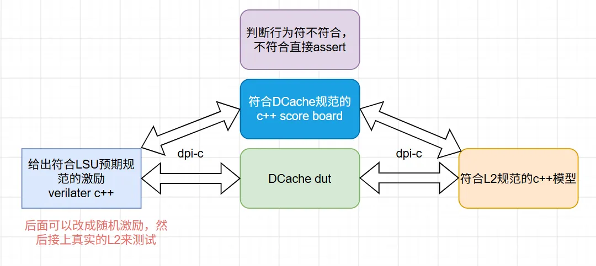

预期效果

这个验证环境也要保证参数化，与DCache的参数化保持一致来进行。

基于当前 DCache 的真实接口，我建议把整个回归环境设计成：
- simCPU：产生 CPU/LSU 侧请求，并处理 DCache 返回的 hit、miss、replay、wakeup。
- simL2Cache：作为 DCache 的外部一致性环境，维护内存、处理 Compact-CHI 事务，并主动发起 Snoop/Probe。
- simDCache：作为独立参考模型和检查器，观察 CPU 接口、L2 接口以及所有握手结果，判断 DCache 是否违反功能或协议。

其中，GPT的建议是，scoreboard不应该相信L2返回的数据，也不应该复用 L2 内部的状态作为唯一参考。 否则 DCache 和 L2 同时出错时，两个错误可能互相掩盖。
只不过我思考如果scoreboard包含了L2,那L2发snoop的话如何实现呢？我觉得还好吧，ai大人实现一个功能100正确的应该不难。架构还是暂时不变

一、公共层：建议增加一个 common 目录
sim/regress/common/
├── sim_config.h
├── sim_types.h
├── chi_types.h
├── line_image.h
├── dut_adapter.h
└── dut_adapter.cpp

建议结构如下：
sim/regress/
├── main.cpp
├── common/
│   ├── sim_types.h
│   ├── chi_types.h
│   ├── line_image.h
│   ├── dut_adapter.h
│   └── dut_adapter.cpp
├── simCPU/
│   ├── cpu_types.h
│   ├── cpu_model.h
│   ├── cpu_model.cpp
│   ├── cpu_scenario.h
│   └── cpu_scenario.cpp
├── simL2Cache/
│   ├── memory_model.h
│   ├── memory_model.cpp
│   ├── l2_model.h
│   ├── l2_model.cpp
│   ├── probe_scheduler.h
│   └── probe_scheduler.cpp
└── simLDCache/
    ├── reference_model.h
    ├── reference_model.cpp
    ├── protocol_checker.h
    ├── protocol_checker.cpp
    ├── scoreboard.h
    └── scoreboard.cpp
当前 Makefile 会递归查找 sim/regress 下的 .cpp 文件，所以这种拆分可以直接被编译进去。

二、`simCPU`：只负责 CPU 侧行为
simCPU 不应该维护 cache tag、cache meta 或 L2 的一致性状态。它只关心：
1. 什么时候向 DCache 发请求；
2. DCache 是否接收；
3. DCache 返回的是 hit、miss、replay 还是完成；
4. miss 之后什么时候重新发起请求；
5. 最终把数据交给 scoreboard 比较。
simCPU/cpu_types.h
定义 CPU 侧操作。

可以把所有操作抽象成统一的 CpuOp：
Load
Store
Atomic
CMO
其中 Load 至少要有：
- op_id
- lane
- vaddr
- paddr
- size
- expected architectural result
- replay count
- state
Store 要有：
- op_id
- line address
- 512 bit store data
- 64 bit byte mask
- command
Atomic 要包含：
- command
- address
- amoData
- amoMask
- amoCmp
- wordIdx
状态建议明确写出来：
Created
WaitingReq
ReqAccepted
WaitingRefill
WaitingReplay
Completed
Failed
不要只用几个布尔变量，否则 Load miss、立即 replay、refill 后 replay 很容易混在一起。

三、`simL2Cache`：作为真正的外部一致性环境

四、`simLDCache`：独立 scoreboard

五、`main.cpp` 只做系统组装和时钟推进

六、建议的实现顺序
不建议一开始同时实现所有随机、Atomic、CMO 和 Probe。更稳妥的顺序是：
第一阶段：通路打通
只支持：
CPU 单 Load
L2 ReadShared
RXDAT 两拍
DCache Load refill
LoadReplay
Load hit
验证：
第一次访问 miss
之后访问 hit
返回数据正确
第二阶段：Store 和写回
加入：
CPU Store
ReadUnique
dirty line
Evict
WriteBackFull
TXDAT 两拍
验证：
partial store
cache line 合并
替换时写回
写回内容正确
第三阶段：反压和乱序
在每条通道独立加入：
ready 随机拉低
RXDAT 延迟
RXRSP 延迟
TXDAT 延迟
重点检查：
payload 稳定性
事务 ID 匹配
多个 MSHR 并行
RXRSP 与 RXDAT 同周期到达
第四阶段：主动 Probe
加入：
clean line probe
dirty line probe
probe 与 refill 并发
probe 与 CPU hit 并发
probe 与 writeback 并发
重点检查：
SnpResp
SnpRespData
dirty 数据是否完整返回
Probe 后 cache line 是否失效或降级
第五阶段：Atomic、CMO 和随机压力
最后加入：
Atomic
LR/SC
CMO
双 Load lane 并发
大量地址冲突
随机 Probe
随机 backpressure

七、这套架构里最需要避免的几个问题
第一，不能让 simL2Cache 和 scoreboard 共用同一个可变内存对象作为唯一依据。两者可以有相同初始内容，但必须独立维护。

第二，不能把一次 resp.valid 当成一次 CPU 操作完成。当前 DCache 的 Load miss 会先返回“已接收”，之后还要等待 loadReplay 再次发起。

第三，不能在每个 cycle 重新生成一个 CHI flit。只要 valid=1 && ready=0，发送端必须保持同一个 flit。

第四，不能用 int 承载 DCache 的宽数据字段。应通过 adapter 转换成 std::array<uint8_t, N> 或 Verilator 支持的宽位数组。

第五，不能让 scoreboard 只检查 CPU 最终返回值。即使 CPU 最终碰巧得到正确数据，内部也可能已经发生：
- TXDAT 两拍顺序错误；
- DBID 错配；
- Probe 响应错误；
- 写回旧数据；
- RXDAT 被错误安装；
- valid/ready 反压时 payload 改变。
这些都应该由独立的协议 checker 报出来。

按照这个思路，后续真正开始写时，第一批应该先写 common 层、`DutAdapter`、单 Load 的 simCPU、ReadShared 的 simL2Cache，以及能检查一次 refill 的最小 scoreboard。这样每个模块的边界会先稳定下来，再逐步扩展 Store、写回和主动 Probe。

回归测试可以有很多
TestRegistry:
    single_load
    load_hit
    load_miss_refill
    bankconflict
    same_line_merge
    set_conflict
    dirty_evict
    probe_clean
    probe_dirty
    probe_during_refill
    backpressure
    two_lane_load
    atomic

    固定测试建议有自己的 TestCase 描述
每个固定测试应该至少包含：
测试名称
初始化动作
CPU 激励序列
L2 延迟策略
Probe 策略
ready/valid 反压策略
期望事件
超时周期
例如 bankconflict 可以描述为：
1. 准备两个不同的地址；
2. 确保它们会访问同一个 DCache bank；
3. 尽量让两条 Load 同周期进入两条 Load lane；
4. 观察是否出现预期的 bank conflict/replay；
5. 重新发起 replay；
6. 检查两个 Load 最终都得到正确数据；
7. 检查没有错误的 cache line 安装。

make all 应该怎么理解？
建议 make all 只跑固定测试集：
make all
它可以依次运行：
single_load_miss
single_load_hit
bankconflict
set_conflict
dirty_evict
probe_clean
probe_dirty
...
每个测试最好单独启动一次仿真进程，而不是在同一个 DUT 实例里连续切换。原因是：
- 每个测试都有独立 reset；
- 失败日志互不污染；
- 波形只对应一个测试；
- 某个测试崩溃不会破坏后续测试；
- 单个测试可以单独复现。
输出可以类似：
[PASS] single_load_miss
[PASS] single_load_hit
[PASS] bankconflict
[FAIL] dirty_evict
[PASS] probe_clean

summary: 4 passed, 1 failed
失败时一定打印：
test name
seed
cycle
最近的 CPU 操作
相关 TxnID
相关地址
当前事务状态

make random 应该怎么设计？
make random 不应该只生成随机 CPU 地址。至少还要随机：
- Load/Store/Atomic 比例；
- 两条 Load lane 的并发情况；
- 地址是否同 line、同 bank、同 set；
- L2 返回延迟；
- 各通道 ready；
- Probe 的时机；
- 是否在 refill 期间发新请求；
- 是否制造 dirty eviction。
建议支持：
make random
make random SEED=1234
make random COUNT=100 SEED=1234
其中 SEED 必须打印出来。失败时可以直接：
make random SEED=1234
复现同一个问题。

随机测试的每个操作也要经过同一套 scoreboard，不应该为随机测试另写一套判断逻辑。

Reference 应该是“语义模型”，不是“RTL 镜像”
如果 reference 也实现一遍：
DCache pipeline
MSHR
MissQueue
WriteBackQueue
ProbeQueue
way replacement
bank arbitration
那么它很容易和 DCache 一起犯同样的错误，最后变成两个相同实现之间互相验证。

我建议把 reference 设计成下面几个相对独立的部分。
ReferenceMemory
ReferenceCacheLineState
CpuOperationTracker
ChiTransactionTracker
ProtocolChecker
Scoreboard